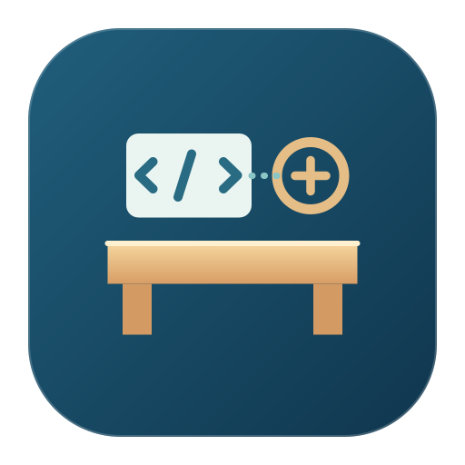
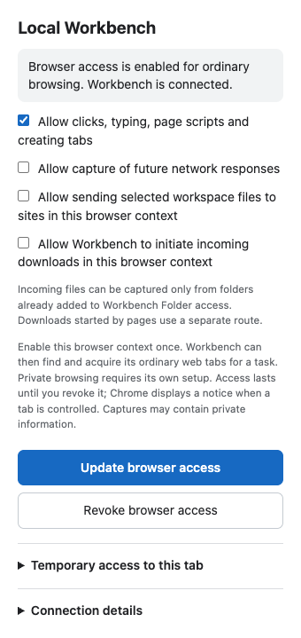

# Local Workbench

Local Workbench is an experimental [Model Context Protocol (MCP)](https://modelcontextprotocol.io/) server for working with local files, processes, and selected browser and macOS resources. It is designed for an assistant working on a local project with the owner's authorization.

The Python server supports MCP over standard input/output and an OAuth-protected HTTP mode. A macOS launcher and browser extension are also included as source. The project is under active development: a feature present in source is not necessarily qualified for every client, app, or browser.

## What it can do

Depending on configuration and granted access, tools can:

- Inspect and edit files in configured workspaces, search text, and work with artifacts and change sets.
- Start and observe commands, retain output, and inspect operation receipts when a response is lost.
- Inspect archives and images and organize related activity into work sessions.
- Open an isolated Chromium browser, observe pages, and interact with them. Separate integrations support selected existing browser tabs and some native macOS workflows, with additional setup and explicit authority.

Capabilities have specific limits and failure modes. In particular, browser or native interaction does not guarantee an application's intended outcome; inspect the result. The server publishes individual tool schemas to connected MCP clients.



*Simulated connection state rendered from the extension popup markup; it does not demonstrate a live connection or readiness.*

## Run the stdio server from source

You need Python 3.11 or newer and an MCP client that can start a local stdio server. From a checkout:

```sh
python3 -m venv .venv
.venv/bin/python -m pip install -e .
mkdir -p examples/work/sandbox
```

The example configuration exposes `examples/work/sandbox` as a read-only, non-executable workspace and keeps server state in `examples/work/state`. Both paths are relative to the configuration file. Start the server from the repository root:

```sh
.venv/bin/python -m local_workbench --config examples/workbench.example.json serve
```

The server speaks MCP on standard input/output, so normally your client should start this command instead of running it interactively. Configure the client with absolute paths to `.venv/bin/python` and the configuration file; the arguments are `-m`, `local_workbench`, `--config`, the configuration path, and `serve`. Client configuration syntax varies.

To use your own folder, copy [the example configuration](examples/workbench.example.json), set its `root` to an existing directory, and choose `writable` and `executable` deliberately. Keep `state_dir` outside all exposed workspaces. Stop the old server before starting another with the same state directory. For the isolated browser tools, install the matching runtime with:

```sh
.venv/bin/python -m playwright install --no-remove chromium
```

## macOS app and remote connections

The native Mac launcher is included as source only. This snapshot does not include a general-purpose app build, signing, or installation procedure. The stdio server is the available source setup described above.

The HTTP server listens on loopback; connecting a remote client requires a separately configured HTTPS endpoint and OAuth setup. A portable remote setup guide is not yet included. The browser extension and native integrations require their own local setup, permissions, and grants; available behavior depends on the application and environment.

## Security and privacy

**Commands run with the operating-system permissions of the user running the server.** Enabling execution is not a sandbox: a command can access resources beyond the configured workspace. Managed file tools enforce their configured workspace boundary, but that does not constrain arbitrary commands or all external applications. Grant only the access needed and connect only clients you trust.

State can contain private authentication data, journals, artifacts, job output, and other retained material. Protect the state directory and review retention before sharing or backing it up. Browser profiles and explicitly selected tabs can contain sensitive data; browser access and macOS permissions are separate from workspace settings. HTTP access should use the documented OAuth and HTTPS configuration.

## Development

Install optional test dependencies with:

```sh
.venv/bin/python -m pip install -e '.[test]'
```

The original development test suite and native delivery tooling are not included in this snapshot. See [the configuration source](src/local_workbench/config.py) and [server source](src/local_workbench/server.py) for current options and tool definitions.
